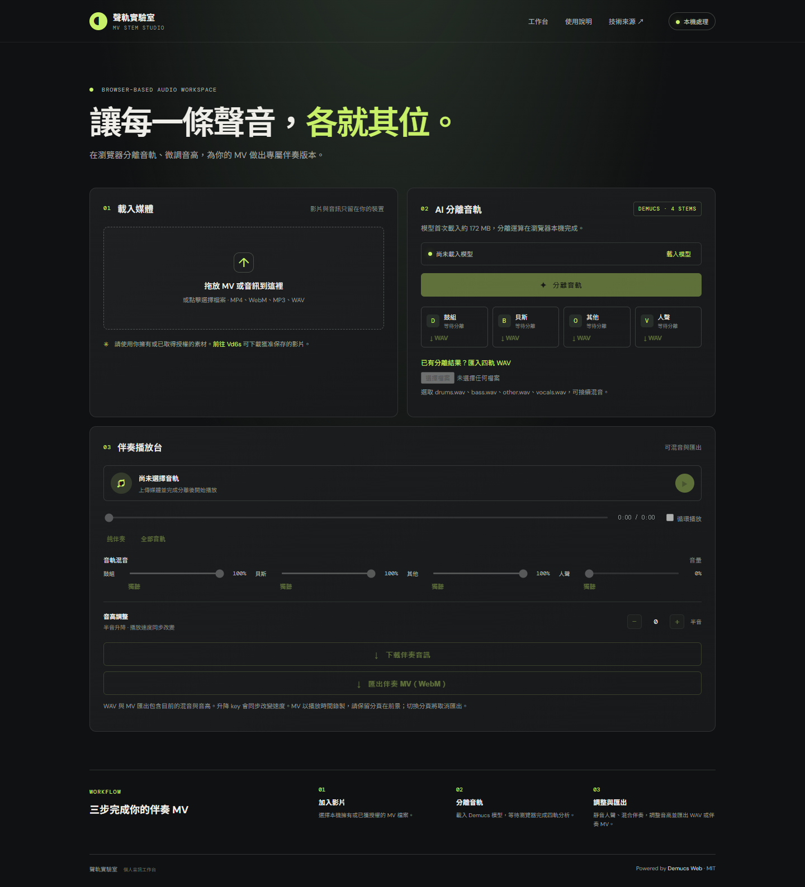
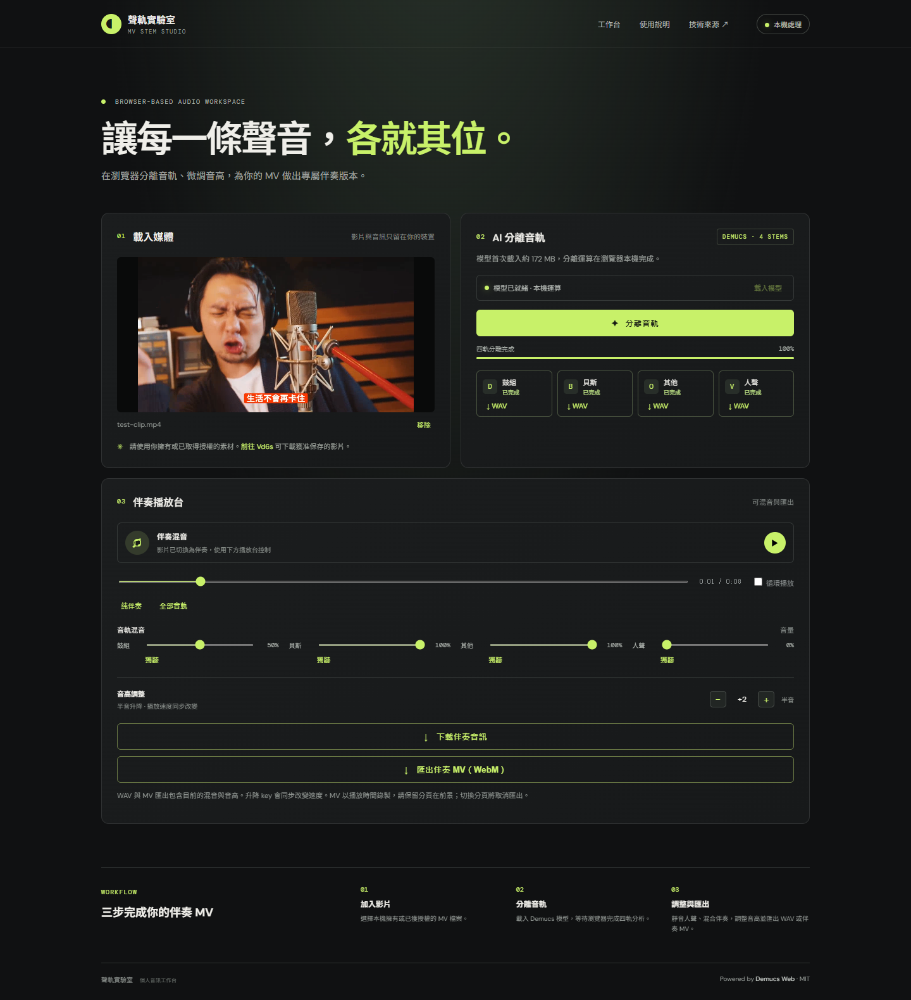
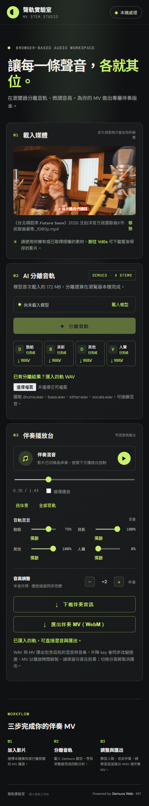
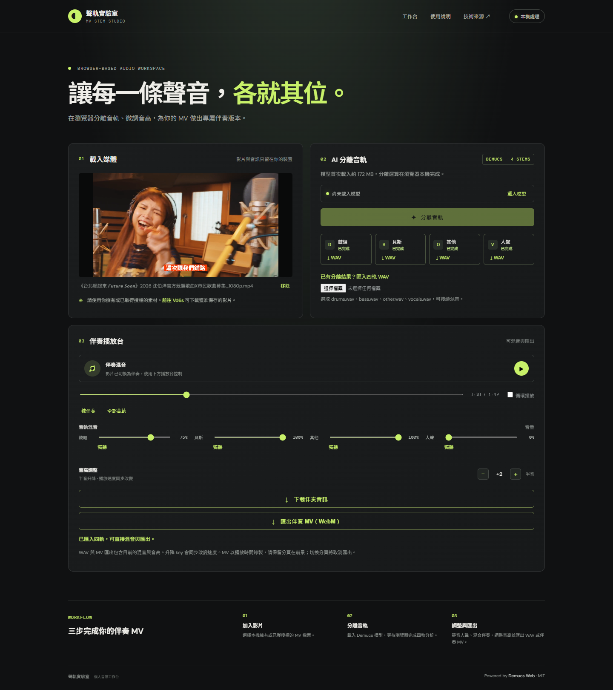

# 伴奏 MV 製作紀錄

製作日期：2026 年 11 月 12 日。

## 六項任務成果

| 任務 | 實作與狀態 |
| --- | --- |
| 1. 取得歌詞 MV | 使用使用者已下載並提供的《台北順起來 Future Soon》MP4，1920×1080、24 fps、約 109.37 秒；不需重複下載。 |
| 2. Demucs 去人聲 | 使用 demucs-web 1.0.2 的 HTDemucs ONNX 模型完成全片四軌推論；本機處理約 82.49 秒。將鼓組、貝斯、其他混成伴奏，再與原始畫面合成 MP4。 |
| 3. 純前端移植 | 網頁以 Worker、ONNX Runtime Web、Web Audio API 運作；實測 Chrome 真實分離 8 秒影片，不需要後端或跨來源隔離標頭。 |
| 4. 額外功能 | 即時混音、獨聽、四軌下載、±6 半音、拖曳進度、循環、WAV／WebM 匯出、匯入四軌、取消運算與手機排版。 |
| 5. GitHub Pages | 已準備正式建置與自動發布流程；目標為使用者指定的 timcsy/demucs-web。登入及實際發布狀態另見交付說明。 |
| 6. 困難與解法 | 詳列於下方。 |

## 功能截圖

圖 1：本機影片選擇、模型載入、四軌區域與播放台；也能匯入已完成的音軌。

圖 2：從原片擷取 8 秒片段，以瀏覽器真正跑完模型，設定鼓組 50%、人聲 0%、音高 +2。此設定的 WAV 約 7.12 秒，符合升兩個半音後速度同步增加的結果。

圖 3：390px 寬度的手機版，已匯入完整四軌；檢查沒有橫向溢出。

圖 4：載入完整原始 MV 與本次產出的四軌，移到 30 秒，鼓組 75%、升 2 key。完整分离在本機完成，這張畫面展示網頁匯入和混音結果。

## 遇到的困難與解決方式

1. **原先沒有 Demucs 與影片處理工具。** 下載指定 ONNX 模型，使用 ONNX Runtime Node 執行 demucs-web 的相同分離流程；補上 FFmpeg，抽出 44.1 kHz 立體聲並重封裝 MP4。這次全片實際完成，沒有以左右聲道抵消冒充 AI 去人聲。
2. **GitHub Pages 無法自訂隔離標頭。** 固定 ONNX Runtime 1.20.1，使用單執行緒 WASM，將 WASM 與載入模組一併打包。本機靜態測試明確檢查 crossOriginIsolated=false，仍完成模型載入與推論。
3. **原版混音會重新生成整段 WAV，拖動音量會中斷播放。** 改成四個同步 AudioBufferSourceNode 與 GainNode，即時改變增益；統一播放台負責影片同步、暫停、續播及跳轉。
4. **音高控制與匯出不一致。** 使用 Web Audio 的播放速率直接改變聲音頻率，匯出時以 OfflineAudioContext 重算，讓下載檔包含升降 key。明確標示速度也會改變。
5. **需要真正的伴奏 MV。** 本次交付 MP4 以 FFmpeg 保留原始影片流，替換為伴奏音訊。網頁另以 Canvas + MediaRecorder 匯出 WebM，實測可解碼且包含音訊、影像，長約 8.02 秒。
6. **AI 運算會阻塞操作、長影片耗用記憶體。** 放到 Worker，顯示處理狀態並支援終止；模型可快取，已有音軌可直接匯入。瀏覽器單執行緒比本機推論慢，不能用本機 82 秒推估網頁全片速度。
7. **測試瀏覽器的格式支援差異。** 測試用 Chromium 無法解碼此 MP4 的 AAC 音軌；改用已安裝的 Chrome 後通過。頁面會顯示解碼錯誤，建議 Chrome／Edge 或先轉 WAV。
8. **上一段 Git 提交受目錄權限阻擋，GitHub 未登入。** 在目前可寫入的環境整理正式建置；GitHub 必須經使用者本人完成裝置登入，不能把未推送的檔案宣稱已上線。

## 本機成果

- `outputs/台北順起來_伴奏MV.mp4`：完整 1080p 伴奏 MV，約 51.4 MB。
- `outputs/accompaniment.wav`：完整伴奏 WAV。
- `outputs/drums.wav`、`bass.wav`、`other.wav`、`vocals.wav`：四個音軌。
- `outputs/browser-accompaniment.webm`、`browser-mix-plus2.wav`：瀏覽器端實測匯出。
- `outputs/separation-result.json` 與 `browser-test-result.json`：運算及測試記錄。

以上影片及音軌保留本機。Demucs 為估計分離，沒有保證完全消除人聲；本次已驗證檔案、音畫流與操作流程，未進行人工逐段聽審。
