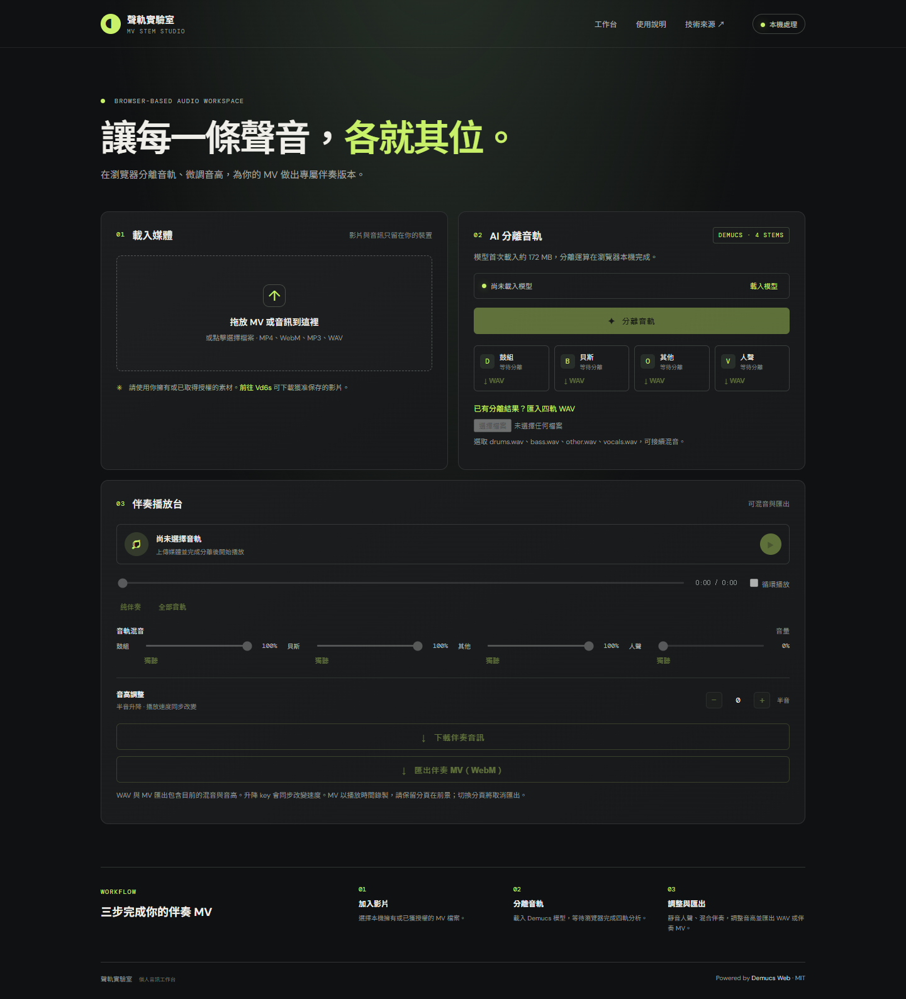

# 聲軌實驗室 · MV Stem Studio

以 [demucs-web 1.0.2](https://github.com/timcsy/demucs-web) 與 HTDemucs ONNX 模型製作的純前端伴奏 MV 工作台。影片與音訊在使用者裝置處理，沒有音訊上傳 API。

## 功能

- 拖放或選取本機影片／音訊，預覽原始內容。
- Demucs 分離鼓組、貝斯、其他樂器、人聲；預設將人聲靜音。
- 即時四軌混音、獨聽、純伴奏／全部音軌預設。
- ±6 半音、暫停／續播、進度拖曳、循環播放及同步 MV。
- 各軌 WAV、套用混音與音高的 WAV、伴奏 MV（WebM）匯出。
- 匯入 drums.wav、bass.wav、other.wav、vocals.wav，直接接續混音。
- 模型快取、取消運算、手機版排版。

## 本機開啟

需要 Node.js 22 以上，執行 `npm ci`、`npm run dev`，開啟顯示的本機網址。正式靜態檔案由 `npm run build` 產生於 `dist/`；不可直接以 file:// 開啟 HTML。

先選擇媒體，再按「載入模型」與「分離音軌」。第一次需從 Hugging Face 下載約 172 MB 模型，單執行緒瀏覽器運算可能明顯慢於本機 ONNX Runtime。保留分頁開啟，可按「取消處理」中止。

已有本次產出的四軌時，選取原始影片後，直接從「匯入四軌 WAV」一次選取四個 WAV，即可播放、調整與匯出。

## GitHub Pages

`.github/workflows/pages.yml` 安裝鎖定依賴、執行測試、建置並僅發布 `dist/`。Repository 的 Settings → Pages → Source 選擇 GitHub Actions。建置使用相對路徑，因此可部署到 repository 子路徑。

ONNX Runtime 1.20.1 設為單執行緒 WASM，在背景 Worker 執行；WASM 與載入模組隨網站一同發布，不需要 COOP/COEP 或 SharedArrayBuffer。已在不提供隔離標頭的 HTTP 靜態環境以 Chrome 實測模型載入、真實推論及匯出。GitHub Pages 公開網址仍以實際部署結果為準。

## 驗證

- `npm test`：驗證人聲排除、雙聲道等比例防削波、WAV 格式與取樣值。
- `npm run build`：Vite 正式建置通過。
- Chrome 實測 8 秒 MP4：真實模型分離、播放、即時音量、+2 半音 WAV、WebM 音畫匯出、390px 排版、清除狀態。
- 完整 109.37 秒 MV：本機 ONNX Runtime 完成同一 Demucs 模型推論，合成 1080p MP4；網頁完整四軌匯入與播放台另有實測。

## 限制

- 半音調整同時改變音高與速度，沒有保留拍速變調。
- 網頁影片匯出為 WebM，約需影片的播放時間；需保持分頁在前景，切換分頁會取消錄製。
- MP4 的音訊解碼取決於瀏覽器，建議使用新版 Chrome／Edge。不支援的格式可先轉為 WAV 或 WebM。
- 分離品質由模型決定，可能殘留人聲或產生音色損失；other 不等於可獨立分離吉他、鋼琴。
- 模型與長音訊佔用較多記憶體，手機或低記憶體裝置可能失敗。
- WAV 混音超過滿刻度時採雙聲道等比例正規化。各軌 WAV 不包含混音或升降 key。
- 使用者影片、完整伴奏與四軌位於被 Git 忽略的 `outputs/`，不納入網站部署。

製作過程與六項任務紀錄見 [EXPERIENCE.md](EXPERIENCE.md)。應用採 MIT 授權，模型與影音素材依各自授權使用。
